# spok1 architecture

These diagrams show the system described in [prd.md](prd.md). The PRD is the source of truth. Where the two disagree, follow the PRD and update this file. Section numbers such as §6 point to sections of the PRD.

Contents:
1. [System context](#1-system-context)
2. [Network and deployment](#2-network-and-deployment)
3. [Inside the VM](#3-inside-the-vm)
4. [How a request runs](#4-how-a-request-runs)
5. [Guardrails and approvals](#5-guardrails-and-approvals)
6. [The brain and sync between machines](#6-the-brain-and-sync-between-machines)
7. [The learning engine](#7-the-learning-engine)
8. [The auditor](#8-the-auditor)
9. [agentd: scheduler, watchers and notifier](#9-agentd-scheduler-watchers-and-notifier)
10. [Project OS](#10-project-os)
11. [Multi-project isolation](#11-multi-project-isolation)
12. [Authentication and connectors](#12-authentication-and-connectors)
13. [Discord layout and routing](#13-discord-layout-and-routing)
14. [Code packages](#14-code-packages)

---

## 1. System context

The whole system from the outside. Every LLM call runs on the unmodified `claude` binary under the Max plan. No API key is used anywhere.

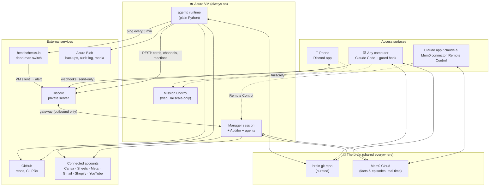

---

## 2. Network and deployment

The VM has **no inbound ports**. Every connection is either outbound from the VM or goes through the Tailscale private network.

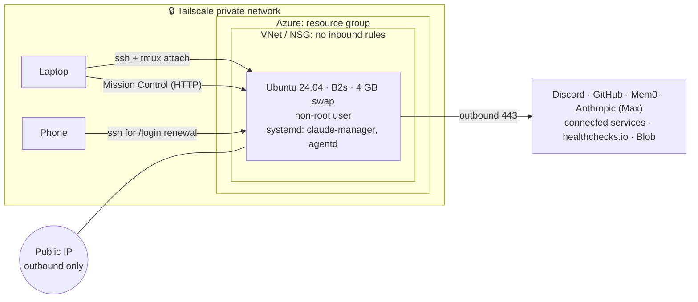

| Unit | Runs | Restart policy |
|---|---|---|
| `claude-manager.service` | `manager-start.sh` → tmux → `claude --channels <discord plugin>` | `Restart=always` |
| `agentd.service` | `spok1-agentd` (uv) | `Restart=always` |
| `backup.sh` (timer) | `~/.claude` state + `learning.db` → Blob (Cool tier, 7 days) | nightly |

---

## 3. Inside the VM

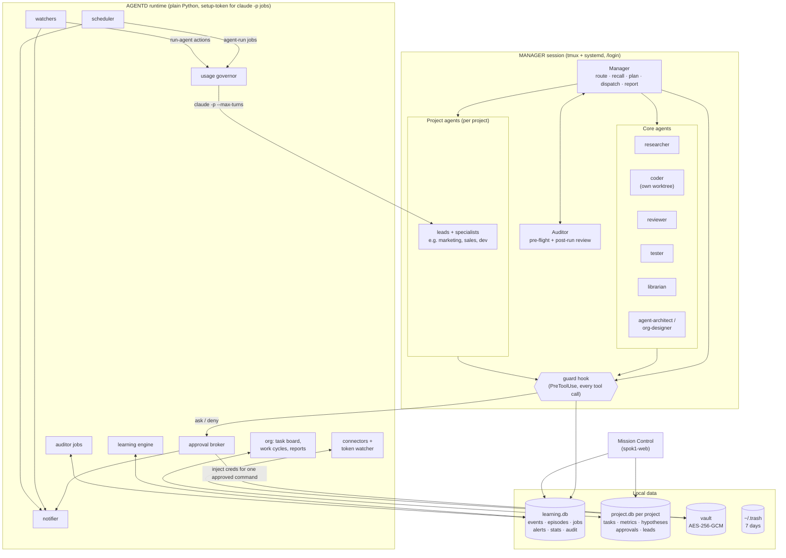

---

## 4. How a request runs

The manager's eight steps (PRD §2): route, recall, plan, pre-flight, dispatch, review, report, debrief.

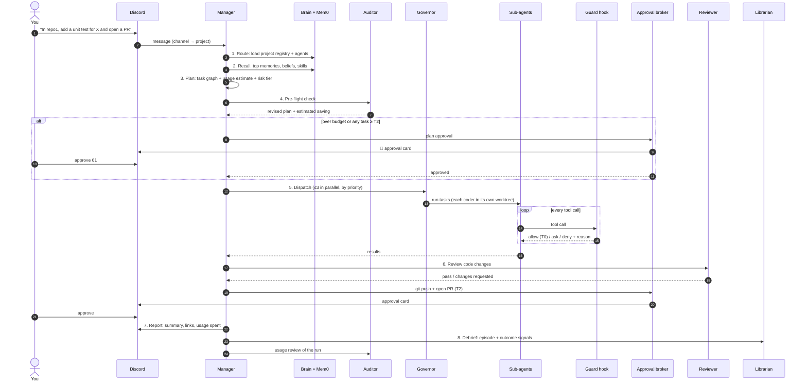

---

## 5. Guardrails and approvals

The guard runs before **every** tool call, on every machine. It is deterministic code with no LLM, so a prompt-injected agent can't argue its way past it.

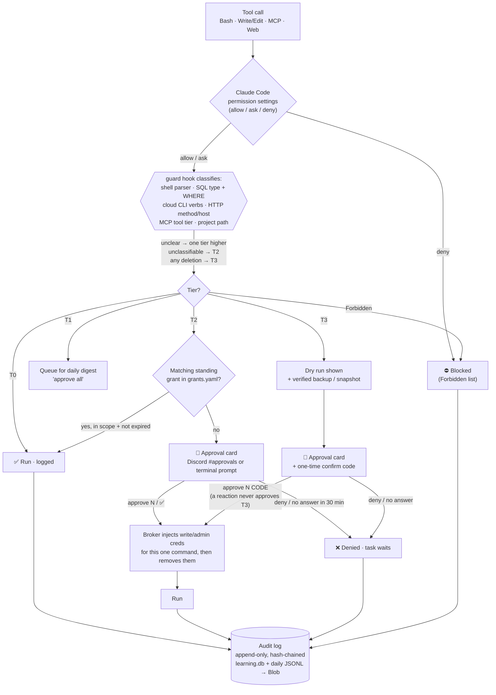

| Tier | Examples | Approval |
|---|---|---|
| **T0** Auto | reads, worktree edits, tests, Mem0 writes, messages to me, learning changes | none, logged |
| **T1** Batch | agent-created reminders, local commits on `agent/*` | one tap in the daily digest |
| **T2** Approve | push/PR, installs, creating any resource, DB writes, messaging anyone else, new LLM jobs, going over budget | per action, or a standing grant |
| **T3** Two-key | any deletion, `DROP`, `rm -rf`, force push, mass actions, new outreach segment, cost > limit | approval + confirm code + backup + dry run; never a grant |
| **Forbidden** | skip-permissions, editing guardrails, setting `ANTHROPIC_API_KEY`, leaking secrets | blocked; I do it by hand |

---

## 6. The brain and sync between machines

Merge conflicts are avoided by design. **Only the VM edits curated files.** Every other writer only adds new, uniquely named files or appends to `feedback.md`.

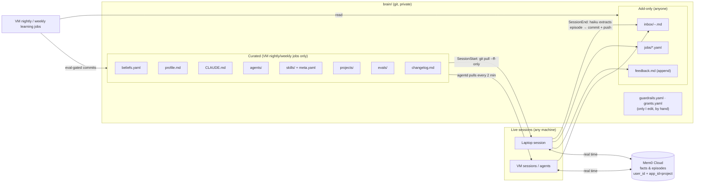

How the brain is linked into Claude Code on every machine:

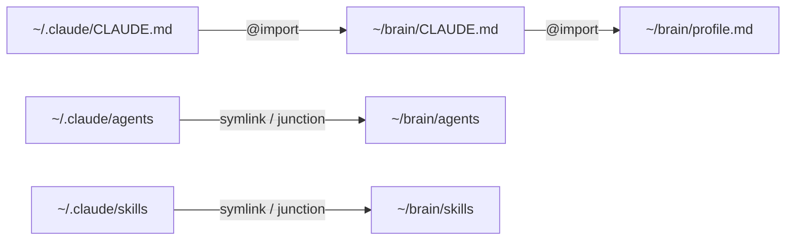

---

## 7. The learning engine

Learning changes the agents' **context** (beliefs, memories, skills, prompts, thresholds, routing), never model weights. Each change is driven by measured outcomes and has to pass the eval gate.

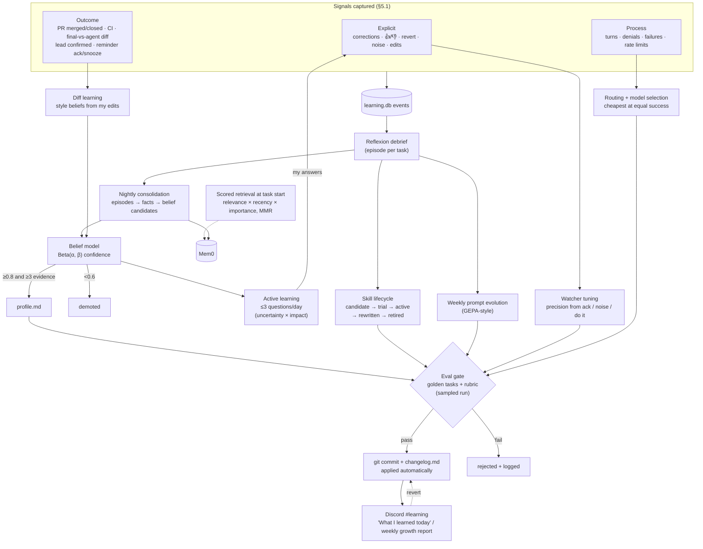

| When | Runs |
|---|---|
| During a task | corrections → `feedback.md` + Mem0; scored retrieval |
| After each task | debrief, signal capture, skill stats |
| Nightly ~02:00 | consolidation, beliefs, profile, skills, diff learning → eval gate → auto-commit → report |
| Weekly | prompt evolution, watcher tuning, pruning, new eval tasks → growth report |

Learning can never create anything that costs usage or reaches outside the brain, and it can never touch the guardrails.

---

## 8. The auditor

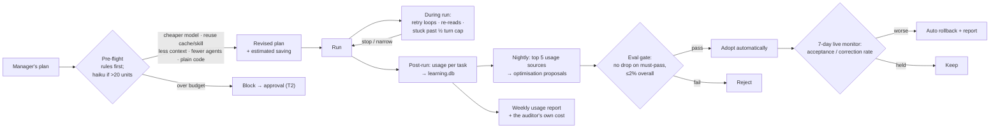

Usage units per turn: **haiku 1 · sonnet 3 · opus 15**, calibrated from `--output-format json`. Budgets are per task, per project per day and per day overall, set in `guardrails.yaml`.

---

## 9. agentd: scheduler, watchers and notifier

```mermaid
flowchart LR
    subgraph In["Inputs"]
        JF["brain/jobs/*.yaml<br/>(pulled every 2 min)"]
        SRC["Sources: GitHub · IMAP/Gmail · HTTP<br/>logs · RSS · CRM sheet · claude auth status"]
    end

    JF --> SCH["Scheduler<br/>(SQLite job table)"]
    SCH -->|"reminder<br/>(no LLM)"| NOT
    SCH -->|"agent-run / digest"| GOV["Governor<br/>queue · ≤3 concurrent<br/>budgets · back-off"]
    GOV -->|"claude -p --max-turns"| Claude["claude binary<br/>(Max, setup-token)"]
    Claude --> NOT

    SRC --> W["Watcher"]
    W --> Rule{"Cheap rule<br/>check"}
    Rule -->|"conclusive"| Act
    Rule -->|"inconclusive"| Haiku["haiku classifier"] --> Act{"Action"}
    Act -->|ping| NOT
    Act -->|"ping+draft"| GOV
    Act -->|run-agent| GOV

    NOT["Notifier<br/>priority · quiet hours<br/>dedup · ≤20/h · alert IDs"]
    NOT -->|"P1: @mention, even in quiet hours"| Alerts["#alerts"]
    NOT -->|"P2: outside quiet hours"| Alerts
    NOT -->|"P3: batched"| Digest["#daily-digest"]

    Alerts --> Reply["ack · snooze · noise · do it<br/>✅ ❌ 🔕 🗑️"]
    Reply -->|"noise → precision"| Learn["learning engine"]
```

The example from PRD §3, the sales lead flow:

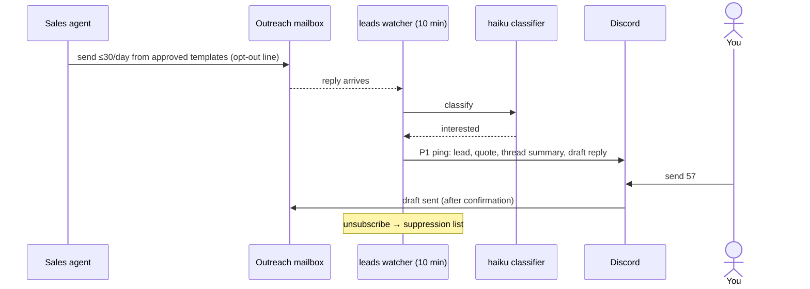

---

## 10. Project OS

Every project, from a one-agent side project to a 25-agent organisation, is the same kind of object. Here is the perfume pilot as an example:

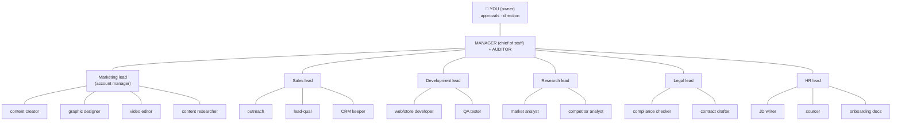

How work flows. Agents run only in **work cycles** or when an event wakes them. Only the manager and agentd run all the time.

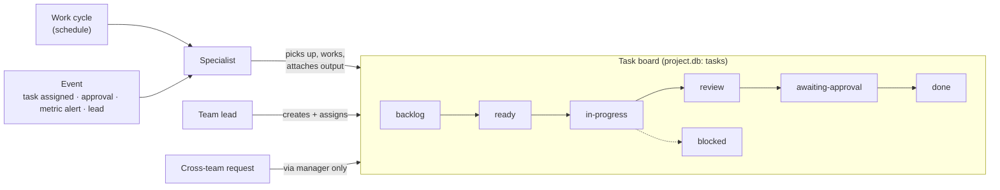

The team improvement loop, using marketing as the example:

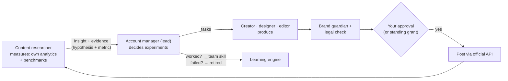

Reports to you:

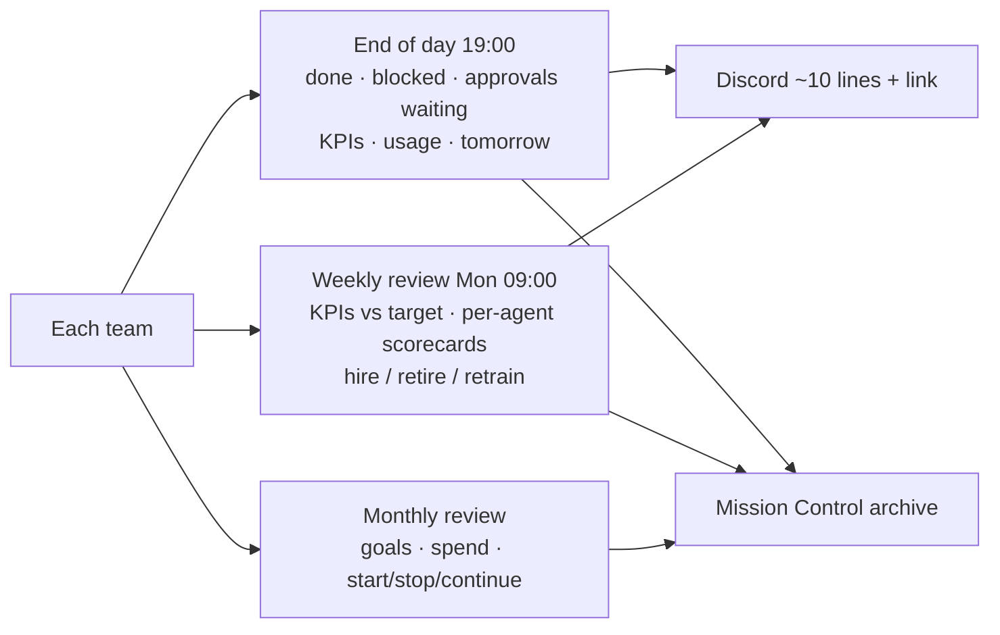

---

## 11. Multi-project isolation

Each project is a self-contained unit. Isolation is **enforced in code**: the guard, the vault and filtered Mem0 searches.

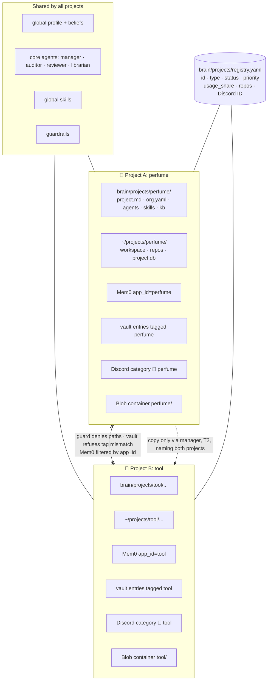

Project lifecycle:

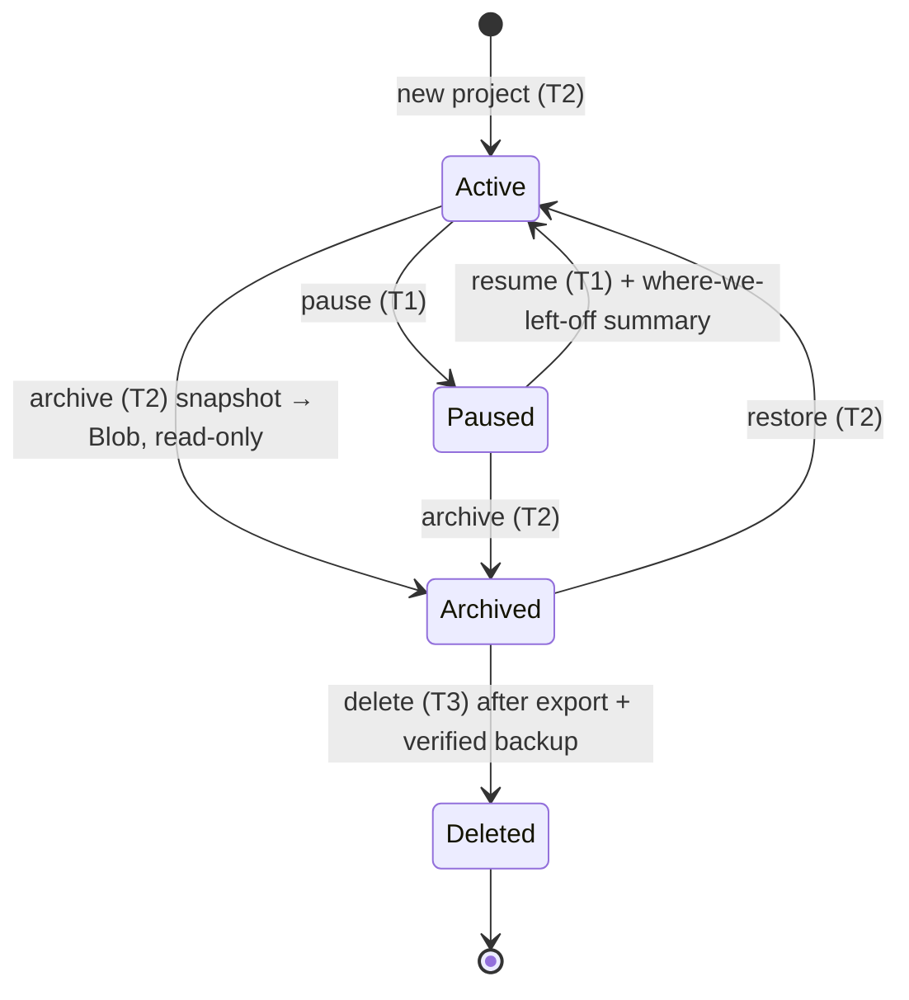

---

## 12. Authentication and connectors

**The model login and the service logins are independent**, so scheduled jobs never depend on claude.ai connectors.

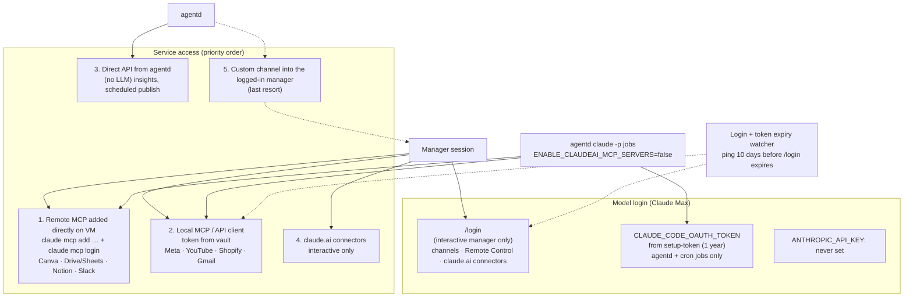

Connecting an account:

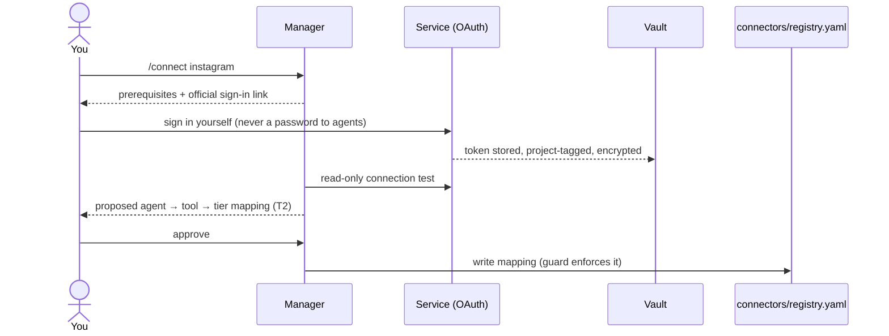

---

## 13. Discord layout and routing

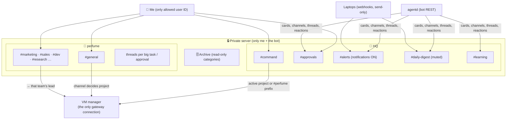

---

## 14. Code packages

The repo is a uv workspace (`packages/spok1-*`, each with a `src/` layout and its own `tests/`). `spok1-core` is the shared library. **`spok1-guard` depends on nothing, not even core**: it runs on every tool call, so it uses only the standard library and starts fast. No package depends on `spok1-cli` or `spok1-web`.

```mermaid
flowchart BT
    CORE["spok1-core<br/>config · schemas · db · audit_log · vault"]
    GUARD["spok1-guard<br/>PreToolUse classifier<br/>(stdlib only, no deps)"]
    AGENTD["spok1-agentd<br/>scheduler · watchers · notifier · governor<br/>approvals · auditor · org · connectors · learning"]
    MCP["spok1-mcp<br/>notify · custom channel · local connector servers"]
    WEB["spok1-web<br/>Mission Control"]
    CLI["spok1-cli<br/>the spok1 command"]

    AGENTD --> CORE
    MCP --> CORE
    WEB --> CORE
    CLI --> CORE
    AGENTD -->|"tier checks for its own actions"| GUARD
    CLI -->|"local control API"| AGENTD

    HOOKS["claude/hooks/*.sh, *.ps1"] -->|"exec"| GUARD
    SETTINGS["claude/settings.*.json"] -.-> HOOKS
```

| Package | Runs on | Started by |
|---|---|---|
| `spok1-core` | everywhere | (library) |
| `spok1-guard` | every machine | the PreToolUse hook, on every tool call |
| `spok1-agentd` | VM only | systemd `agentd.service` |
| `spok1-mcp` | VM + laptops (`notify`), VM (channel, connectors) | Claude Code, as MCP servers |
| `spok1-web` | VM only | agentd / systemd, bound to the Tailscale interface |
| `spok1-cli` | everywhere | me |
